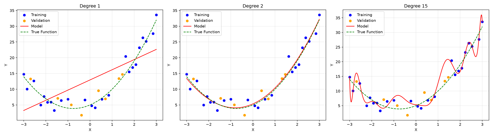
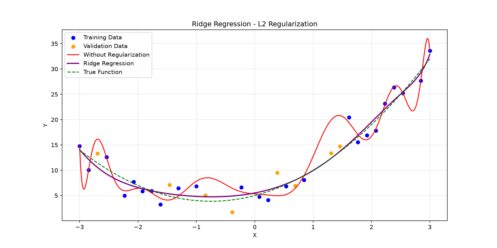
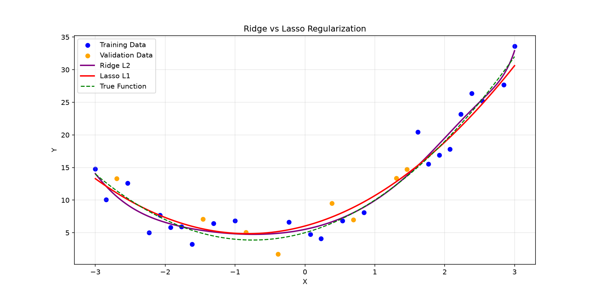

# 🧠 Machine Learning Optimization Lab

An interactive end-to-end Machine Learning project exploring model complexity, generalization, regularization and hyperparameter optimization.

## Project Overview

This project demonstrates how different Machine Learning models behave when trained on nonlinear data containing random noise.

The objective is to understand underfitting, overfitting and the bias-variance tradeoff, while improving model generalization through regularization and cross-validation.

## Technologies

- Python
- NumPy
- Pandas
- Matplotlib
- Scikit-learn
- Streamlit
- Joblib

## Machine Learning Concepts

- Polynomial Regression
- Feature Engineering
- Underfitting and Overfitting
- Bias-Variance Tradeoff
- L1 and L2 Regularization
- Ridge Regression
- Lasso Regression
- Feature Selection
- Standardization
- Machine Learning Pipelines
- K-Fold Cross-Validation
- GridSearchCV
- Model Persistence
- Inference

## Dataset

The project uses 40 synthetic observations generated from a quadratic function with Gaussian noise.

The data is separated into training, validation and test sets.

## Model Comparison

| Model | Training MSE | Validation MSE |
|---|---:|---:|
| Linear Regression — Degree 1 | 34.1678 | 40.1621 |
| Polynomial Regression — Degree 2 | 4.1483 | 3.5509 |
| Polynomial Regression — Degree 15 | 0.7397 | 18.8684 |
| Ridge Regression | 3.8020 | 4.0106 |
| Lasso Regression | 4.6301 | 3.4859 |

## Underfitting vs Overfitting



## Ridge Regularization



## Lasso Regularization



## Hyperparameter Optimization

GridSearchCV evaluates 36 candidate configurations using 5-fold cross-validation, resulting in 180 cross-validation fits.

Best configuration:

- Algorithm: Linear Regression
- Polynomial Degree: 2
- Cross-Validation MSE: 4.5055

## Final Test Performance

| Metric | Value |
|---|---:|
| MAE | 1.5561 |
| MSE | 4.7811 |
| RMSE | 2.1866 |
| R² | 0.9082 |

## Interactive Dashboard

The Streamlit application contains three sections:

- Model Playground
- Model Optimization
- Prediction with the Saved Model

## Installation

Create a virtual environment:

```powershell
python -m venv .venv
```

Activate it on Windows:

```powershell
.\.venv\Scripts\Activate.ps1
```

Install dependencies:

```powershell
python -m pip install -r requirements.txt
```

## Train and Save the Model

```bash
python src/generate_data.py
python src/grid_search.py
```

## Run the Application

```bash
python -m streamlit run app.py
```

## Example Prediction

For an input value of X = 2.0, the saved model predicts Y = 19.4087.

## Project Structure

```text
02-model-optimization/
├── data/
├── models/
├── plots/
├── src/
│   ├── generate_data.py
│   ├── visualize.py
│   ├── polynomial_regression.py
│   ├── underfitting.py
│   ├── overfitting.py
│   ├── compare_models.py
│   ├── ridge.py
│   ├── lasso.py
│   ├── grid_search.py
│   └── predict.py
├── app.py
├── requirements.txt
├── .gitignore
└── README.md
```

## Limitations

This is an educational project based on a small synthetic dataset. The final evaluation uses only eight test observations, so the results should not be interpreted as statistically robust.

Only load serialized Joblib models from trusted sources.

## Reference

Inspired by *Grokking Machine Learning, Second Edition*, by Luis G. Serrano.